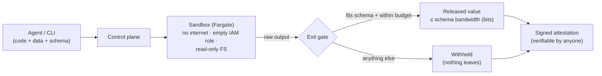

# Keyhole

**Let an AI agent answer questions about private data it never gets to see.**

You can look through a keyhole; you can't carry the furniture out through it. The agent writes
code; the code runs next to the data; the only thing that comes back is a typed answer (a label, a
count, a score) no wider than the data owner allows — measured in **bits**, capped in total per
dataset, and recorded in a **signed receipt**. Nobody reviews the code: the owner approves the
*size of the answer* instead.

## The problem

A hospital wants a vendor's model to score its patient records. A bank wants a fraud vendor's code
to run over its transactions. An AI agent wants to write and run a script over your customer table.
In every case, someone must currently hand over their crown jewels: the data owner ships the data,
or the code owner ships the code — and with AI agents, the code was written seconds ago and nobody
has reviewed it.

Running that code in a sandbox doesn't fix this. A sandbox stops code from **escaping the box**; it
then hands back **whatever the code returns**. If the code read your customer table, the customer
table can walk out inside the answer.

## Why existing tools don't cover it

| Approach | How it controls what leaves | Why it misses this case |
|---|---|---|
| Agent sandboxes (E2B, Modal, Daytona, AgentCore) | network egress allowlists | whatever the code returns goes straight back into the agent's context |
| Clean rooms with arbitrary Python (Databricks, Snowflake, Decentriq) | humans approve each notebook or function | review does not scale to code an agent wrote seconds ago |
| PySyft | the data owner reviews each code request | same: a person in the loop per request |
| Agent information-flow control (CaMeL, FIDES) | labels and a quarantined model | no quantitative bound on what an implicit flow can carry |
| DLP / content scanning | known patterns in output | defeated by encoding before emitting |
| Differential privacy | individuals in aggregates | needs a statistical query model, not general code |

Keyhole takes a known idea — bounded information leakage, from information-flow research and the
confinement problem (Lampson, 1973) — and makes it a practical layer for the case none of these
cover: **arbitrary code, no human review, a number for what left, and a receipt.** It sits on top
of a sandbox rather than competing with one: the sandbox keeps the code in; Keyhole decides what
comes out.

## Measured

`make bench` runs both, offline and reproducibly:

| Benchmark | Plain code-execution tool | Keyhole |
|---|---|---|
| **Canaries** — 4 analytic questions over a 500-row table seeded with 1,000 canaries; each asked by honest code and by prompt-injected code | 4/4 correct; **4,000 canaries** reached the agent; 1.17M bits returned | 4/4 correct; **0 canaries**; 41 bits returned |
| **Leaderboard probing** — recover 64 hidden test labels by flipping one prediction per scoring query | 64/64 recovered in 65 queries | **4/64**, then refused (32-bit budget, shared by every identity) |

## The idea in one number

Before the code runs, the caller declares the shape of the answer, e.g.
`{"type": "enum", "choices": ["spam", "ham", "other"]}`. Three possible answers can carry at most
log₂3 = **1.58 bits**. The example customer file is **3,312 bits**. It does not fit — no matter how
cleverly it's encoded, because this is a limit on *size*, not a search for *content*.

```bash
sbx run examples/classify.py --data customers.csv=examples/customers.csv \
    --schema schemas/label.json --local
# → status: succeeded   output: "spam"   bandwidth: 1.58 bits

sbx run examples/exfil.py --data customers.csv=examples/customers.csv \
    --schema schemas/label.json --local
# → status: withheld    output does not conform to the declared schema   (nothing released)
```

On top of that one idea:

- **The owner sets the policy, on the dataset.** The widest answer one run may carry and the total
  that may ever leave. A schema wider than the cap is refused before anything runs; the budget is
  the dataset's, shared by every caller, so a new identity buys nothing.
- **Mock data for writing the code.** The owner attaches stand-in rows of the same shape. Runs on
  the mock return full output and tracebacks; runs on the real data return only the answer.
- **A signed receipt for every run.** It binds the hashes of the code, data and schema, the exact
  output, the bits charged and the running total, who was involved, and which sandbox ran the code.
- **A real box.** Locally, code runs under bubblewrap: no network, your home and Keyhole's signing
  key hidden (or in a locked-down Docker container with `KEYHOLE_SANDBOX=docker`). On AWS it runs on Fargate in a subnet with no internet route, an empty IAM role and an
  S3 endpoint policy that admits only Keyhole's own bucket; receipts are signed by KMS.

## See it

```bash
python -m pip install -e '.[dev]'
make showtime              # paced visual walkthrough of everything above (~3 min)
make showtime-dashboard    # second terminal: the same runs in the browser
```

`make demo` is the 10-second, non-interactive version.

## How it works



The code runs in one trust domain; the **exit gate** runs in another. The code has full freedom
inside the box and no authority over the gate, so it can't change the schema it's judged by. The
gate checks, in order: can the caller afford this run → does the output fit the schema → how many
bits could it carry → does a secondary DLP scan flag it → release. It charges the budget and signs
a receipt either way.

## What it guarantees — and what it doesn't

Keyhole never claims "zero leakage": the confinement problem proves that's impossible for code that
can see the data. It claims a **disclosed ceiling**.

- **Guaranteed:** a released answer carries at most the schema's bandwidth — the gate releases a
  value rebuilt from the schema, never the code's own object, and a brute-force test counts every
  value it can release to check the bound; anything that doesn't fit is withheld; every run is
  signed and tamper-evident.
- **Bounded, not zero:** code can choose *which* allowed answer to give — or to give none. Every
  non-release outcome looks identical to the caller (crashes, timeouts and exit codes go only to the
  data owner's audit log), so one run reveals at most log₂(N + 1) bits: 2 bits for three labels.
  The budget charges every run that amount, released or not.
- **Found and closed:** an audit of the first version found the bound could be beaten six ways
  (unbounded integers, multi-byte strings, `1` vs `1.0` vs `true`, array length, key order, NaN),
  that clean-room providers chose their own schema, and that run duration was returned to the
  caller. Each now has a hostile test. See [`SECURITY.md`](SECURITY.md).
- **Out of scope:** timing side channels, what a legitimate answer itself reveals, and breaking
  AWS's own isolation. See [`SECURITY.md`](SECURITY.md).

## Use cases

- An AI agent analyzing private data it should never be able to take away.
- Two-party computation: hospital records × vendor model, bank transactions × fraud vendor, ad
  measurement.
- Untrusted marketplace plugins running over user data.
- Scoring a model against a secret benchmark without revealing the benchmark.

The rule of thumb: Keyhole fits when **the data is more sensitive than the answer is large.**

## Usage

### From an AI agent (MCP)

The data owner registers a dataset with its exit policy and grants the agent:

```bash
sbx dataset add customers.csv=./customers.csv --owner acme \
    --max-bits-per-run 12 --budget-bits 256 \
    --describe "customers: name,email,ssn,region,spend,churned" \
    --mock customers.csv=./customers.mock.csv                     # → ds-1eebc2b917c4
sbx dataset grant ds-1eebc2b917c4 --to agent

pip install -e '.[mcp]'
claude mcp add keyhole -- keyhole-mcp                             # Claude Code
```

The agent gets three tools: `list_datasets` (description, mock rows, budget left), `run` with
`on="mock"` (full output, free) or `on="real"` (the bounded answer only), and
`run_confidential_tool`, which takes data inline from the agent — useful only for bounding what
comes back from processing content the agent does not trust. Any other MCP host:
`{ "mcpServers": { "keyhole": { "command": "keyhole-mcp", "env": { "KEYHOLE_PRINCIPAL": "agent" } } } }`

From Python, without MCP:

```python
import keyhole
keyhole.list_datasets(principal="agent")
keyhole.run("ds-1eebc2b917c4", code, {"type": "enum", "choices": ["north", "south"]},
            principal="agent", on="mock")   # then on="real"
```

### Two-party clean room

The same commands, with a partner as the code provider:

```bash
sbx run classify.py --dataset ds-1eebc2b917c4 --grant grant-… \
    --principal partner-ai --schema schemas/label.json [--on mock]
# → succeeded   output: "spam"   budget: 2.00/256.00 bits of this dataset (all providers)
#   attestation binds {acme, partner-ai, ds-1eebc2b917c4}

# A schema wider than the owner allows is refused before anything runs:
# → refused: schema could carry 480000.01 bits per run; the data owner allows at most 12.00
```

Grants are unguessable bearer tokens (production would sign and time-box them), and owner/provider
separation is enforced by the control plane rather than by IAM.

### Verify a receipt

```bash
sbx run … --save-attestation att.json
sbx verify att.json                         # VALID   (local ed25519 dev key)
sbx verify att.json --pubkey kms.pem        # VALID   (cloud: ecdsa-p256 via KMS)
```

### Deploy to your AWS account

```bash
infra/terraform/environments/dev/stack.sh up     # build, terraform apply, push sandbox image
export KEYHOLE_API_ENDPOINT=…                    # printed by `up`
export KEYHOLE_API_KEY=…                         # from .env; the API refuses requests without it
sbx run classify.py --data emails.csv=./emails.csv --schema schemas/label.json \
    --save-attestation att.json                  # submit → poll → released + KMS-signed
sbx verify att.json --pubkey /tmp/kms.pem
infra/terraform/environments/dev/stack.sh down   # back to ≈ $0
```

Lambda + API Gateway control plane, DynamoDB audit log, Fargate sandbox, KMS signing key. About
$0.03/hour while up (VPC endpoints), ≈ $0 when torn down. `stack.sh` reads AWS keys from the
repo-root `.env` (`AWS_ACCESS_KEY`, `AWS_SECRET_KEY`), plus `KEYHOLE_API_KEY` for callers and
`KEYHOLE_OWNER_KEY` for owner routes (registering datasets and grants, reading the audit).

The clean room works the same way in the cloud: `sbx dataset add … --cloud` and
`sbx dataset grant … --cloud` (owner key) register the dataset and its policy with the control
plane; `sbx run --dataset … --grant …` (caller key) runs against it. The control plane loads the
bytes from S3 itself, refuses schemas over the cap, and charges the dataset's budget with one
atomic DynamoDB update before launching anything. Cloud budgets are cumulative (no rolling
window), and mock runs are local-only: callers get the mock rows from `GET /datasets/{id}`.

### Dashboard

`sbx dashboard` serves a read-only, self-contained viewer of local runs (`~/.keyhole`) on
http://127.0.0.1:8787 — no framework, no CDN. Its centerpiece is the **exit aperture**, a log-scale
gauge from 1 bit to 1 MB, so a bounded exit reads as the sliver it is. Drop an attestation file on
it to verify.

## Status

- **Local:** full pipeline — owner-set policy, mock runs, typed exit, bandwidth accounting, exit
  gate, per-dataset budget, ed25519 receipts, bubblewrap sandbox, MCP server, Python API, dashboard.
- **Cloud:** deployed and verified end to end on real AWS (honest answer released and KMS-signed,
  exfiltrator withheld, internet probe blocked). Since then: API auth, an S3 endpoint policy,
  separate uids inside the task, result-envelope validation and a run deadline. These are
  unit-tested and the image runner is tested in Docker, but **not yet re-verified on AWS**; the
  smoke test now also probes DNS and foreign-bucket writes.
- **Adversarial:** `tests/hostile/` attacks every claim — bulk dump, every way to widen the bound,
  run-status and timing side channels, crash paths, drip across runs, sandbox escapes, clean-room
  wide-schema and identity-switching, attestation tamper.

Next: see [`docs/FUTURE-SCOPE.md`](docs/FUTURE-SCOPE.md).

## Layout

| Path | What |
|---|---|
| `src/keyhole/schema/` | The narrow exit and its bandwidth accounting — the core guarantee. |
| `src/keyhole/controlplane/gate.py` | The exit gate: budget → validate → bandwidth → DLP → release → charge → sign. |
| `src/keyhole/attest/` | Signed, verifiable attestations (ed25519 locally, KMS in the cloud). |
| `src/keyhole/executor/` | Local executor matching the cloud contract. |
| `src/keyhole/cli/`, `src/keyhole/mcp/` | CLI (`sbx`) and MCP server. |
| `infra/terraform/` | AWS deploy (no NAT; ≈ $0 idle). |
| `tests/hostile/` | Hostile scripts that try to exfiltrate — and can't. |
| `benchmarks/` | Canary and leaderboard-probing benchmarks against a plain code tool. |
| `docs/book/` | The decision book: every design choice and why. |
| `STUDY-GUIDE.md`, `DEMO.md` | Interview prep and the live-demo runbook. |

## Develop

```bash
python -m pip install -e '.[dev]'
make test        # unit + hostile suite (install bubblewrap for the sandbox tests)
make bench       # canary + leaderboard benchmarks
make lint
sbx doctor       # check your environment
```

## License

MIT.
